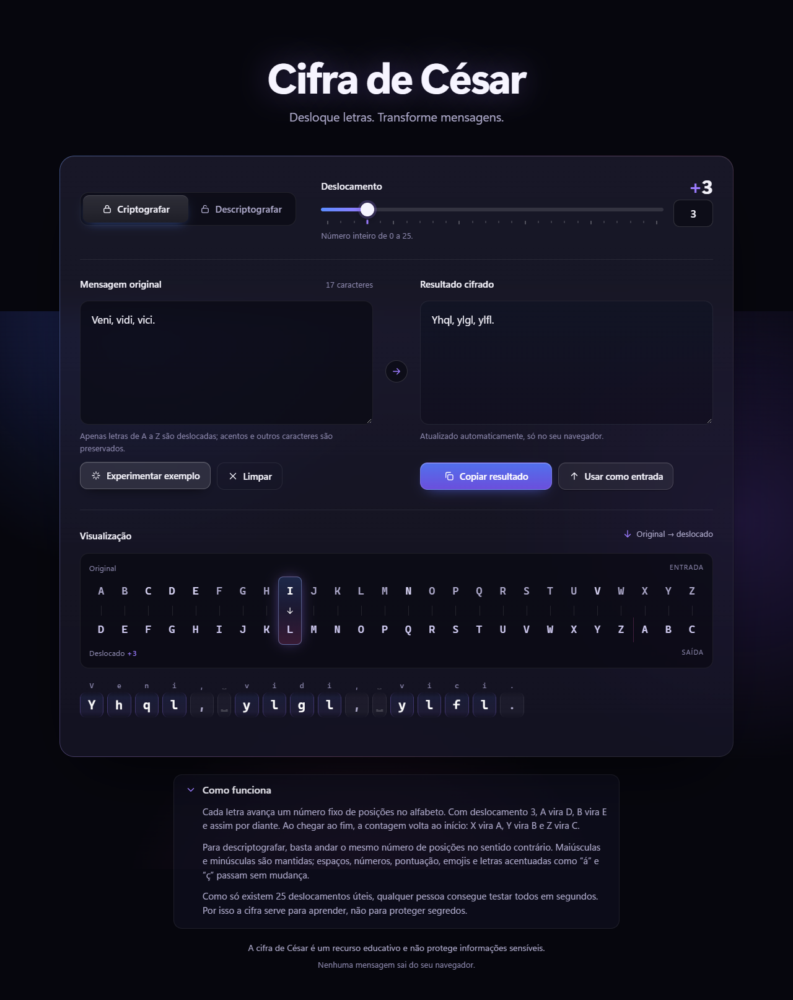
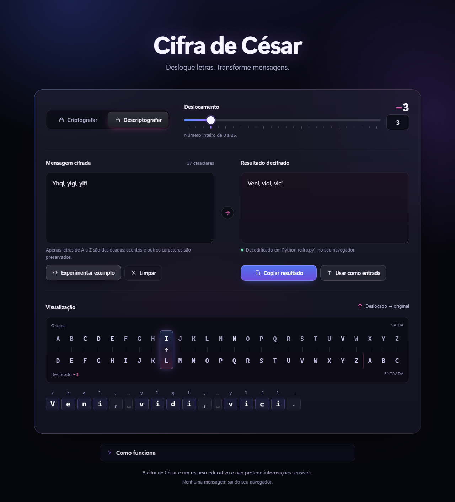
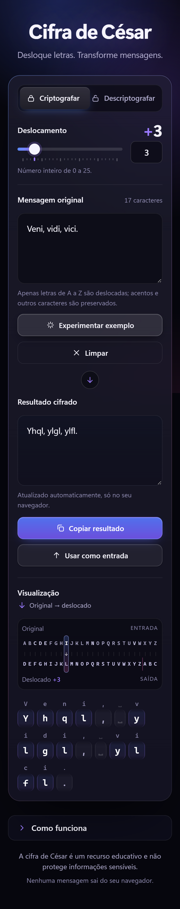

# Cifra de César

<div align="center">
<a href="https://raw.githack.com/Pedrssa/cifra-de-cesar/main/demo/index.html"></a>

<h3><a href="https://raw.githack.com/Pedrssa/cifra-de-cesar/main/demo/index.html">▶ Abrir o preview interativo</a></h3>
<sub>Roda direto dos arquivos deste repositório (pasta <code>demo/</code>): digite, mova o slider, troque o modo.</sub>
</div>

Aplicação web para criptografar e descriptografar mensagens com a cifra de César,
com animações que mostram cada letra percorrendo o deslocamento.

- **Criptografia:** TypeScript (`src/lib/caesar.ts`).
- **Descriptografia:** Python (`python/cifra.py`), executado no próprio navegador
  via [Pyodide](https://pyodide.org). A mensagem nunca sai do navegador; só o
  interpretador Python é baixado do CDN na primeira vez.

> A cifra de César é um recurso educativo e não protege informações sensíveis.

## Preview interativo

**[raw.githack.com/Pedrssa/cifra-de-cesar/main/demo/index.html](https://raw.githack.com/Pedrssa/cifra-de-cesar/main/demo/index.html)**

A pasta [`demo/`](demo) guarda o app já compilado; o link acima a entrega direto do
repositório, sem servidor nem GitHub Pages. Para atualizar a demo depois de mudar o código:

```bash
npm run build:demo && git add demo && git commit -m "Atualiza a demo"
```

Alternativa com ambiente de desenvolvimento completo:
[](https://codespaces.new/Pedrssa/cifra-de-cesar?quickstart=1)

<details>
<summary>Capturas de tela</summary>

| Criptografar | Descriptografar (Python) |
| --- | --- |
|  |  |

<p align="center"></p>
</details>

## Rodar localmente

```bash
npm install
npm run dev
```

## Testes

```bash
npm test                         # lógica da cifra (Node)
python -m unittest discover python   # decodificador em Python
npm run build && npm run test:e2e    # navegador (Edge, via playwright-core)
node scripts/preview-svg.mjs         # regera a prévia animada (docs/preview.svg)
```

O decodificador também funciona pelo terminal:

```bash
python python/cifra.py "Roá, Pxqgr! 123" 3   # → Olá, Mundo! 123
```
